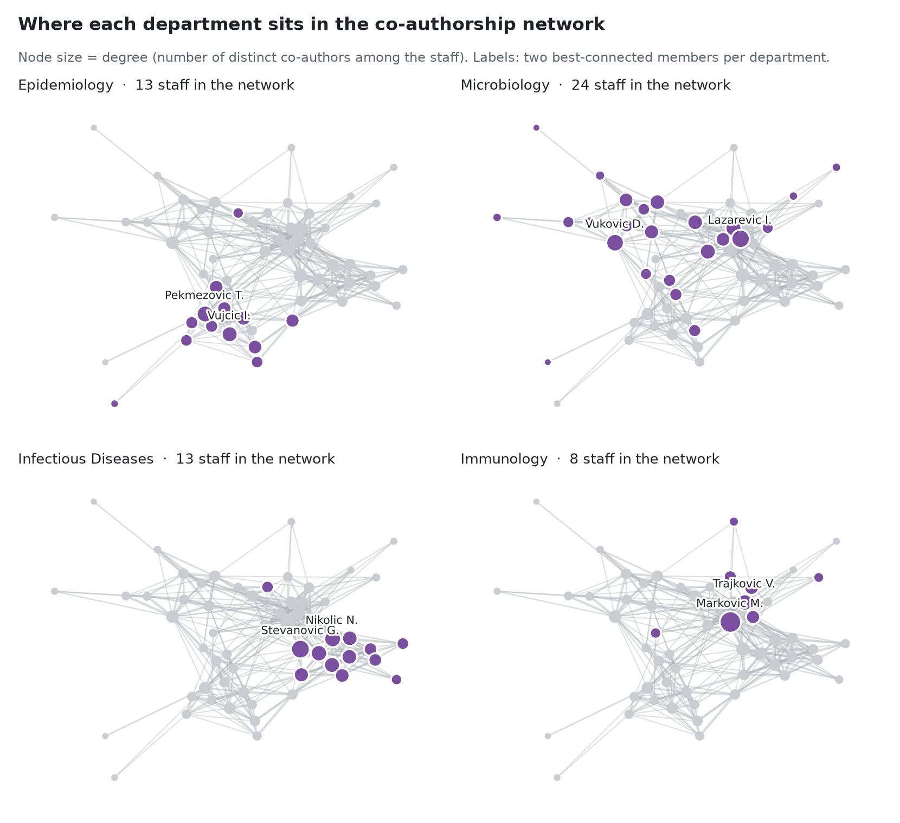
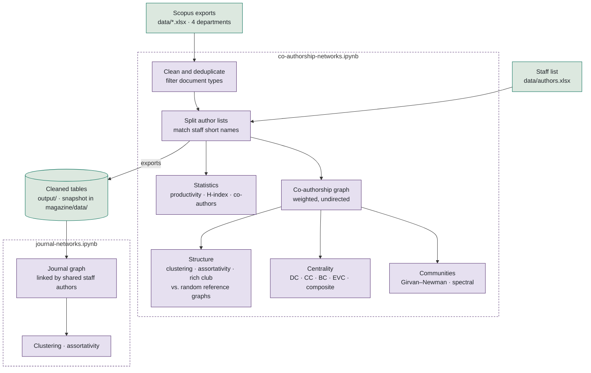
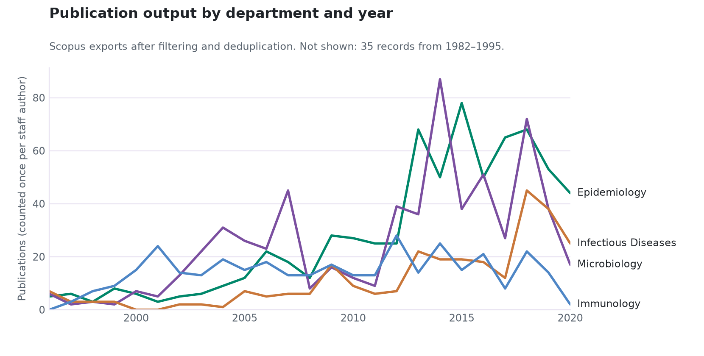
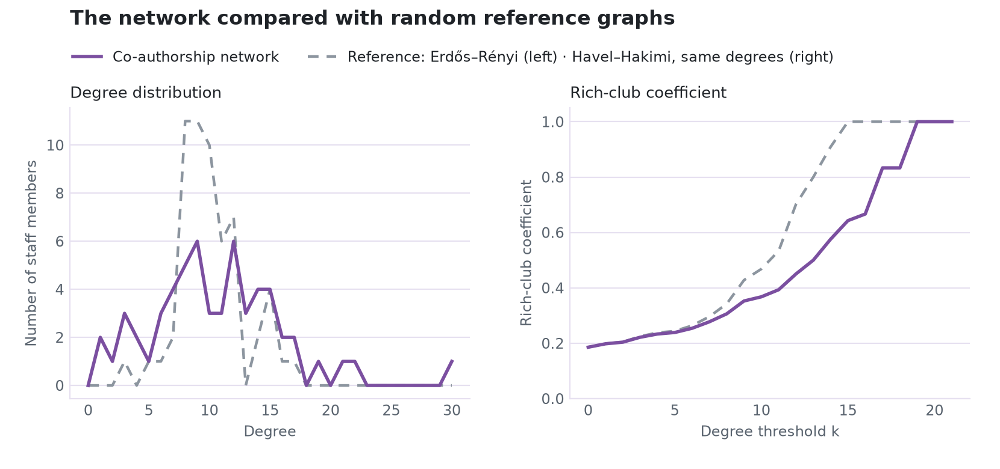
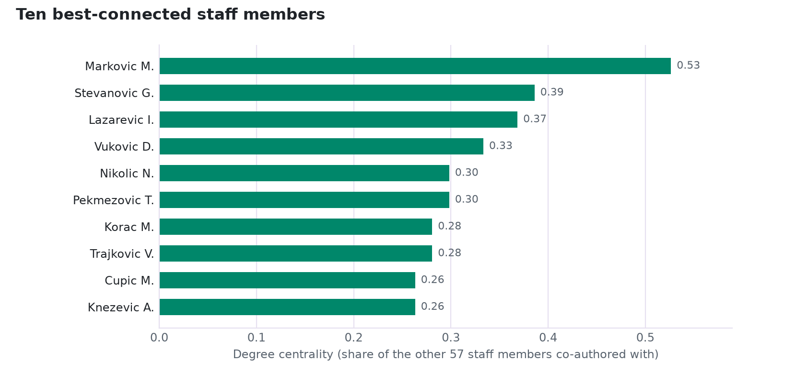
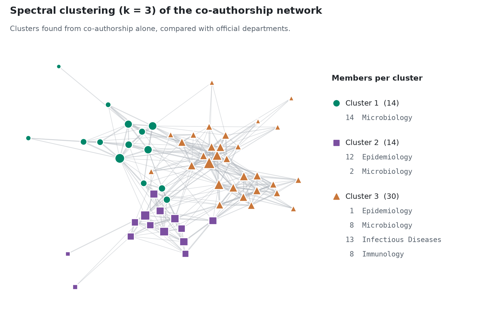
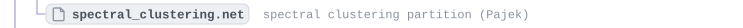

# Scientific Collaboration Networks · Faculty of Medicine, University of Belgrade


A social network analysis of **scientific collaboration among 59 staff members of four departments** at the Faculty of Medicine, University of Belgrade (Epidemiology, Immunology, Infectious Diseases and Microbiology), built from **Scopus publication exports covering 1982–2020**. The project models two networks, a **co-authorship network** of staff members and a **journal network** linked through shared authors, and analyses them with descriptive statistics, graph metrics, centrality measures, random reference models and community detection.

It was developed as the second project assignment of the master's course *Social Network Analysis* at the School of Electrical Engineering, University of Belgrade, by **Lazar Davidović** and **Luka Simić**.

<picture>
  <source media="(prefers-color-scheme: dark)" srcset="docs/figures/network-departments-dark.png">
  
</picture>

| | Co-authorship network | Journal network |
|---|---|---|
| Nodes | 58 staff members | 536 journals |
| Edges | 307 co-author pairs | 22,495 journal pairs |
| Edge weight | number of joint publications | number of staff authors who published in both journals |
| Density | 0.186 | 0.157 |
| Average clustering coefficient | 0.557 | 0.833 |
| Degree assortativity | −0.041 | −0.012 |

---

## Table of contents

1. [Project overview](#project-overview)
2. [Key features](#key-features)
3. [Technology stack](#technology-stack)
4. [Project architecture](#project-architecture)
5. [Methodology and algorithms](#methodology-and-algorithms)
6. [Results and visualizations](#results-and-visualizations)
7. [Project structure](#project-structure)
8. [Installation and setup](#installation-and-setup)
9. [Usage and execution guide](#usage-and-execution-guide)
10. [Testing](#testing)
11. [Known limitations](#known-limitations)
12. [Future improvements](#future-improvements)
13. [Authors](#authors)

---

## Project overview

Scientific output is one of the main criteria used to evaluate researchers, approve projects and accredit doctoral programmes. Publication counts alone do not show *how* research is done: who works with whom, whether departments collaborate or stay separate, and which people hold the network together.

This project answers those questions with network analysis:

- **Who are the most productive and most influential researchers**, and which departments do they belong to?
- **How strongly do the four departments collaborate**, and do communities found from co-authorship alone match the official departments?
- **What is the structure of the network**: is it a small world, is it assortative, does it have a rich club, and how does it compare with random graphs of the same size?
- **Which journals are connected through the same authors**, and how is that journal network structured?

The analysis follows the 26 research questions of the course assignment. The full write-up with every question and answer is in [docs/Presentation.pdf](docs/Presentation.pdf), and a short technical summary is in [docs/Documentation.md](docs/Documentation.md).

## Key features

- **Data cleaning pipeline** for four Scopus exports: ASCII transliteration of names, document-type filtering, removal of irrelevant columns, per-department and cross-department deduplication.
- **Author matching** of free-text Scopus author lists against the official staff list.
- **Bibliometric statistics**: publications per author, average number of co-authors, H-index recomputed from citation counts and compared with the official values, productivity by year, department and journal, and the ratio of faculty to external co-authors.
- **Weighted co-authorship network** (NetworkX) with clustering, assortativity, degree distribution and rich-club analysis.
- **Random reference models**: Erdős–Rényi, G(n, m), scale-free and a Havel–Hakimi graph with the same degree sequence.
- **Centrality analysis**: degree, closeness, betweenness and eigenvector centrality, Kendall τ correlation between them, and a composite rank.
- **Community detection**: Girvan–Newman dendrogram, spectral clustering (scikit-learn) and Louvain clustering in Gephi.
- **Journal network** built from the cleaned author–publication table.
- **Reproducible results**: fixed random seeds and a stable node order, so re-running the notebooks produces byte-identical graph files.
- **Automated tests** that check the input data and execute both notebooks end to end.

## Technology stack

| Area | Used |
|---|---|
| Language | Python 3.12 (tested on 3.12.3) |
| Notebooks | JupyterLab 4, ipykernel |
| Data processing | pandas 3, NumPy 2, openpyxl (Excel I/O), Unidecode |
| Network analysis | NetworkX 3.6 |
| Statistics and clustering | SciPy (Kendall τ, dendrogram), scikit-learn (spectral clustering) |
| Visualization | Matplotlib, seaborn; Gephi for the Louvain community renders |
| Testing | pytest, nbclient, nbformat |

Exact versions are pinned in [requirements.txt](requirements.txt) and [requirements-dev.txt](requirements-dev.txt).

## Project architecture

The project is two Jupyter notebooks that run in sequence. The first notebook cleans the raw data, answers the statistical questions and analyses the co-authorship network. It also exports the cleaned tables, and the second notebook builds the journal network from them. A committed copy of those tables in `magazine/data/` lets the second notebook run on its own.



| Component | Responsibility | Writes |
|---|---|---|
| `co-authorship-networks.ipynb` §1 | Load, clean, filter and deduplicate the Scopus exports; prepare the staff list | `output/authors_data.xlsx`, `output/combined_works.xlsx` |
| `co-authorship-networks.ipynb` §2.1 | Statistical questions 1–9 | `output/works_per_authors.xlsx`, `output/authors_and_works.xlsx` and two summary tables |
| `co-authorship-networks.ipynb` §2.2–2.3 | Network construction, structure, reference models, centrality | `models/network_one.gml`, `models/havel_hakimi.gml`, `images/local_cc_*.png` |
| `co-authorship-networks.ipynb` §3 | Girvan–Newman dendrogram and spectral clustering | `models/spectral_clustering.net` |
| `journal-networks.ipynb` | Journal network and its characterization | `magazine/models/journal-networks.gml`, `magazine/images/*.png` |
| `scripts/make_readme_figures.py` | Renders the figures in this README from the saved results | `docs/figures/*.png` |

## Methodology and algorithms

### 1. Data preparation

| Department | Raw Scopus rows | After document-type filter | After deduplication | Staff members |
|---|---:|---:|---:|---:|
| Epidemiology | 673 | 665 | 514 | 13 |
| Immunology | 368 | 344 | 272 | 8 |
| Infectious Diseases | 273 | 266 | 152 | 13 |
| Microbiology | 661 | 638 | 386 | 25 |
| **All departments** | | | **1,265 unique publications** | **59** |

1. **Transliteration.** Names, titles and journal names are converted to ASCII with `unidecode`, so that `Marković` and `Markovic` are the same string. Hyphens in surnames are replaced by spaces.
2. **Document types.** Only *Article, Article in Press, Review, Book Chapter, Letter* and *Note* are kept.
3. **Deduplication.** Inside each department a publication is a duplicate when `Authors`, `Title`, `Year`, `Source title` and `Document Type` match. After the four departments are combined, duplicates are removed again, because a paper co-authored by two departments appears in both exports.
4. **Staff list.** The headers of `authors.xlsx` (Serbian: *Ime, Prezime, Katedra, H indeks, Broj radova*) are mapped to English. Every staff member gets a Scopus-style short name, `Surname I.` (for example `Markovic M.`).
5. **Author matching.** Each publication's author list is split into one row per author, and every author string that contains a staff short name is replaced by that short name. An inner join with the staff list gives the **staff member × publication** table (2,003 rows, 1,257 publications with at least one staff author). 58 of the 59 staff members are matched.

### 2. Network models

**Co-authorship network** $G = (V, E, w)$: undirected and weighted.

- $V$: the 58 matched staff members.
- An edge $(u, v) \in E$ when $u$ and $v$ co-authored at least one publication.
- $w(u, v)$: the number of publications they co-authored.

**Journal network** $J$: undirected and weighted.

- Nodes: the 536 distinct journal titles in the staff member × publication table.
- An edge links two journals when the same staff author published in both. Its weight is the number of such authors.

### 3. Network metrics

| Metric | Definition used | NetworkX function |
|---|---|---|
| Connected components | count and sizes | `nx.connected_components` |
| Average clustering | mean of local coefficients $C_i$ | `nx.average_clustering` |
| Global clustering (transitivity) | $3 \times$ triangles / connected triples | `nx.transitivity` |
| Weighted local clustering | geometric mean of normalized weights (Onnela et al.) | `nx.clustering(G, weight="weight")` |
| Degree assortativity | Pearson correlation of degrees at the two ends of an edge | `nx.degree_assortativity_coefficient` |
| Rich-club coefficient | density of the subgraph of nodes with degree greater than $k$ | `nx.rich_club_coefficient(normalized=False)` |

**Reference models.** The network is compared with graphs of the same size, all generated with `seed=42`:

- `gnm_random_graph(n, m)`: exactly $n$ nodes and $m$ edges.
- `erdos_renyi_graph(n, p)` with $p = 2m / (n(n-1))$.
- `scale_free_graph(n)`.
- `havel_hakimi_graph(degree_sequence)`: the same degree sequence as the real network. This is the null model for the rich-club comparison.

### 4. Centrality and the composite rank

For every staff member the notebook computes **degree (DC)**, **closeness (CC)**, **betweenness (BC)** and **eigenvector (EVC)** centrality. The agreement between the four measures is measured with **Kendall's τ**. The heuristic used to find the most important actors is a **composite rank**:

$$\text{composite}(v) = r_{DC}(v) \cdot r_{CC}(v) \cdot r_{BC}(v) \cdot r_{EVC}(v)$$

where $r_X(v)$ is the rank of $v$ by measure $X$ (1 is best, ties get the average rank). The smallest product identifies the actors who rank highly by all four measures at once.

### 5. Community detection

- **Girvan–Newman**: repeatedly removes the edge with the highest betweenness. The full hierarchy is converted to a SciPy linkage matrix and drawn as a dendrogram.
- **Spectral clustering**: `SpectralClustering(n_clusters=3, affinity="precomputed", assign_labels="discretize")` on the weighted adjacency matrix. The partition is saved as a Pajek file for Gephi.
- **Louvain**: modularity maximisation in Gephi at several resolution values (the course report found that values around 1.5 give communities close to the departments).

## Results and visualizations

All numbers and charts below come from running the notebooks in this repository. The charts in `docs/figures/` are rendered by [scripts/make_readme_figures.py](scripts/make_readme_figures.py) from the saved result files. The Louvain images are Gephi exports from the original project.

### Productivity and citations

<picture>
  <source media="(prefers-color-scheme: dark)" srcset="docs/figures/publications-per-year-dark.png">
  
</picture>

| Department | Citations (sum) | Publications (counted per staff author) | Faculty : external co-authors¹ |
|---|---:|---:|---:|
| Microbiology | 24,960 | 650 | 372 : 21,055 (0.018) |
| Immunology | 17,509 | 356 | 317 : 5,262 (0.060) |
| Epidemiology | 7,862 | 706 | 504 : 11,640 (0.043) |
| Infectious Diseases | 2,389 | 291 | 193 : 2,206 (0.087) |

<sub>¹ As computed in the notebook (question 9): only publications with exactly one staff author from the given department are included. External co-author counts are inflated by consortium papers with more than 100 authors (43 papers, at most 2,469 authors).</sub>

- **Epidemiology** has the most publications, but **Microbiology** and **Immunology** collect far more citations.
- At the faculty level the most productive year is **2018** (207 staff-author publications).
- The most frequent journal is *Archives of Biological Sciences* (86 publications).
- **H-index check:** 54 staff members have an H-index in the official list. The value recomputed from the Scopus citation counts matches it exactly for **41** of them and is within ±1 for **46** (Pearson r = 0.98).

### Network structure

| Metric | Co-authorship network | Erdős–Rényi reference (same n, p) | Journal network |
|---|---:|---:|---:|
| Nodes / edges | 58 / 307 | 58 / 293 | 536 / 22,495 |
| Density | 0.186 | 0.177 | 0.157 |
| Connected components | 1 | 1 | 1 |
| Diameter | 4 | 3 | 3 |
| Average shortest path | 2.08 | 1.95 | 1.87 |
| Average clustering | **0.557** | 0.173 | 0.833 |
| Transitivity | 0.447 | 0.177 | 0.655 |
| Degree assortativity | −0.041 | — | −0.012 |

<sub>Density, diameter and average shortest path were computed from the saved graphs for this table; the course report lists the same values, computed in Gephi. The notebooks print the other values.</sub>

<picture>
  <source media="(prefers-color-scheme: dark)" srcset="docs/figures/reference-models-dark.png">
  
</picture>

- **Small world.** The whole network is one component with an average distance of about two steps, as in a random graph of the same density, while its clustering is **3.2 times higher** (0.557 vs 0.173).
- **No assortative mixing.** The assortativity coefficient is −0.041 (−0.033 when weighted), very close to zero and slightly negative: well-connected researchers are not especially likely to work with each other.
- **No rich club.** For degree thresholds between about 8 and 18 the rich-club coefficient is clearly *below* that of the Havel–Hakimi graph with the same degrees (by up to 0.36), and both reach 1 only for the two or three top nodes. The best-connected researchers are less interlinked than the degree sequence alone would predict, which fits the near-zero assortativity.
- The degree distribution is broad (degree 1 to 30, mean 10.6). One staff member, `Markovic M.`, has 30 co-authors among the staff, eight more than anyone else.

### Key actors

<picture>
  <source media="(prefers-color-scheme: dark)" srcset="docs/figures/top-degree-centrality-dark.png">
  
</picture>

Top five by the composite rank:

| Author | Degree | Closeness | Betweenness | Eigenvector |
|---|---:|---:|---:|---:|
| Markovic M. | 0.526 | 0.679 | 0.181 | 0.315 |
| Stevanovic G. | 0.386 | 0.600 | 0.063 | 0.264 |
| Lazarevic I. | 0.368 | 0.576 | 0.062 | 0.251 |
| Vukovic D. | 0.333 | 0.594 | 0.100 | 0.177 |
| Pekmezovic T. | 0.298 | 0.576 | 0.107 | 0.146 |

The four centrality measures agree strongly (Kendall τ between 0.59 and 0.79, all p < 10⁻¹⁰). The weakest agreement is between betweenness and eigenvector centrality: some researchers act as bridges without being part of the densest core.

### Communities

<picture>
  <source media="(prefers-color-scheme: dark)" srcset="docs/figures/spectral-clusters-dark.png">
  
</picture>

With three clusters, spectral clustering recovers department structure from co-authorship alone. **Cluster 1** is purely Microbiology. **Cluster 2** is almost all of Epidemiology. **Cluster 3** joins all of Infectious Diseases and Immunology with part of Microbiology. Microbiology, the largest department, is split across all three clusters.

Louvain clustering in Gephi gives the same picture. At a low resolution the network splits into many small groups. At a higher resolution (≈ 1.5) about five communities form that largely follow the departments.

<table>
  <tr>
    <td width="50%"></td>
    <td width="50%"></td>
  </tr>
  <tr>
    <td align="center"><sub>Louvain, lower resolution: many smaller communities</sub></td>
    <td align="center"><sub>Louvain, resolution ≈ 1.5: communities close to the departments</sub></td>
  </tr>
</table>

### Journal network

The 536 journals form one component with a diameter of 3. They are very strongly clustered (average clustering 0.833), because each prolific author connects every journal they published in. Assortativity is close to zero (−0.012). Clustering and assortativity plots are in [magazine/images/](magazine/images/).

## Project structure

<!-- project-tree:start -->
<p>
<a href="https://github.com/LazarDavidovic98/social-network-analysis" title="social-network-analysis"></a><br>
<a href="https://github.com/LazarDavidovic98/social-network-analysis/blob/main/co-authorship-networks.ipynb" title="co-authorship-networks.ipynb"></a><br>
<a href="https://github.com/LazarDavidovic98/social-network-analysis/blob/main/journal-networks.ipynb" title="journal-networks.ipynb"></a><br>
<a href="https://github.com/LazarDavidovic98/social-network-analysis/tree/main/data" title="data/"></a><br>
<a href="https://github.com/LazarDavidovic98/social-network-analysis/blob/main/data/authors.xlsx" title="data/authors.xlsx"></a><br>
<a href="https://github.com/LazarDavidovic98/social-network-analysis/blob/main/data/epidemiology.xlsx" title="data/epidemiology.xlsx"></a><br>
<a href="https://github.com/LazarDavidovic98/social-network-analysis/blob/main/data/immunology.xlsx" title="data/immunology.xlsx"></a><br>
<a href="https://github.com/LazarDavidovic98/social-network-analysis/blob/main/data/infectious_diseases.xlsx" title="data/infectious_diseases.xlsx"></a><br>
<a href="https://github.com/LazarDavidovic98/social-network-analysis/blob/main/data/microbiology.xlsx" title="data/microbiology.xlsx"></a><br>
<a href="https://github.com/LazarDavidovic98/social-network-analysis/tree/main/magazine" title="magazine/"></a><br>
<a href="https://github.com/LazarDavidovic98/social-network-analysis/tree/main/magazine/data" title="magazine/data/"></a><br>
<a href="https://github.com/LazarDavidovic98/social-network-analysis/tree/main/magazine/images" title="magazine/images/"></a><br>
<a href="https://github.com/LazarDavidovic98/social-network-analysis/blob/main/magazine/models/journal-networks.gml" title="magazine/models/journal-networks.gml"></a><br>
<a href="https://github.com/LazarDavidovic98/social-network-analysis/tree/main/models" title="models/"></a><br>
<a href="https://github.com/LazarDavidovic98/social-network-analysis/blob/main/models/network_one.gml" title="models/network_one.gml"></a><br>
<a href="https://github.com/LazarDavidovic98/social-network-analysis/blob/main/models/havel_hakimi.gml" title="models/havel_hakimi.gml"></a><br>
<a href="https://github.com/LazarDavidovic98/social-network-analysis/blob/main/models/spectral_clustering.net" title="models/spectral_clustering.net"></a><br>
<a href="https://github.com/LazarDavidovic98/social-network-analysis/tree/main/images" title="images/"></a><br>
<a href="https://github.com/LazarDavidovic98/social-network-analysis/blob/main/scripts/make_readme_figures.py" title="scripts/make_readme_figures.py"></a><br>
<a href="https://github.com/LazarDavidovic98/social-network-analysis/tree/main/tests" title="tests/"></a><br>
<a href="https://github.com/LazarDavidovic98/social-network-analysis/tree/main/docs" title="docs/"></a><br>
<a href="https://github.com/LazarDavidovic98/social-network-analysis/blob/main/requirements.txt" title="requirements.txt"></a><br>
<a href="https://github.com/LazarDavidovic98/social-network-analysis/blob/main/requirements-dev.txt" title="requirements-dev.txt"></a><br>
<a href="https://github.com/LazarDavidovic98/social-network-analysis/blob/main/pytest.ini" title="pytest.ini"></a><br>
</p>

<sub>Every row is a link to that file or folder on GitHub. Purple: folders, green: source code, grey: configuration, data and docs.</sub>
<!-- project-tree:end -->

## Installation and setup

**Requirements:** Python 3.12 (the pinned NumPy and SciPy releases need Python 3.12 or newer; the project was tested on 3.12.3) and Git. All data is in the repository, so no database, API key or download is needed.

```bash
git clone https://github.com/LazarDavidovic98/social-network-analysis.git
cd social-network-analysis
```

Create a virtual environment and install the dependencies:

```powershell
# Windows (PowerShell)
py -3.12 -m venv .venv
.venv\Scripts\Activate.ps1
python -m pip install -r requirements.txt
```

```bash
# macOS / Linux
python3.12 -m venv .venv
source .venv/bin/activate
python -m pip install -r requirements.txt
```

For the tests, install `requirements-dev.txt` instead. It includes `requirements.txt`.

> The setup and every command below were verified on Windows 11 with Python 3.12.3. The macOS/Linux commands are the standard equivalents.

## Usage and execution guide

### Interactive (JupyterLab)

```bash
jupyter lab
```

Open and run the notebooks with **Run → Run All Cells**, in this order:

1. **`co-authorship-networks.ipynb`** (about 20 s). Prints the cleaning statistics, answers the statistical questions, builds and analyses the co-authorship network and writes its results:
   - `output/*.xlsx`: the cleaned intermediate tables (git-ignored)
   - `models/network_one.gml`, `models/havel_hakimi.gml`, `models/spectral_clustering.net`
   - `images/local_cc_main_network.png`, `images/local_cc_er_network.png`, `images/local_cc_random_scale_free_network.png`
2. **`journal-networks.ipynb`** (about 20 s). Reads the committed tables in `magazine/data/`, so it also works without running the first notebook. It writes `magazine/models/journal-networks.gml` and the plots in `magazine/images/`.

The notebooks use paths relative to the repository root, so start Jupyter from that folder.

### Headless

```bash
jupyter nbconvert --to notebook --execute co-authorship-networks.ipynb --output-dir output/executed
jupyter nbconvert --to notebook --execute journal-networks.ipynb --output-dir output/executed
```

The executed copies, with all outputs, are written to `output/executed/`. The source notebooks are not changed.

### Regenerating the README figures

```bash
python scripts/make_readme_figures.py
```

This reads `models/network_one.gml`, `models/spectral_clustering.net` and `magazine/data/*.xlsx` and writes a light and a dark version of every chart to `docs/figures/`.

### Using the saved graphs

The graphs can be loaded without running the notebooks, for example in Gephi or with NetworkX:

```python
import networkx as nx

G = nx.read_gml("models/network_one.gml")
print(G.number_of_nodes(), G.number_of_edges())        # 58 307
print(sorted(G.degree, key=lambda x: -x[1])[:3])      # [('Markovic M.', 30), ('Stevanovic G.', 22), ('Lazarevic I.', 21)]
```

## Testing

```bash
python -m pip install -r requirements-dev.txt
python -m pytest              # all 14 tests, about 1 minute
python -m pytest -m "not slow"   # only the fast data checks, a few seconds
```

| Test file | What it checks |
|---|---|
| `tests/test_data.py` | The four Scopus exports have the expected 15 columns. The staff list has the headers the notebook maps. The journal network inputs exist. The saved co-authorship graph (58 nodes, 307 edges, connected, integer weights) and the saved journal graph (undirected, 536 nodes) are valid. |
| `tests/test_notebooks.py` (`slow`) | Runs **both notebooks end to end** with nbclient in a temporary copy of the project, fails on any cell error, and checks that the regenerated graphs are identical to the committed ones. |

The notebook tests run in a temporary folder, so they never change the working tree.

## Known limitations

- **Name matching is approximate.** A Scopus author string is assigned to a staff member when it *contains* their short name. This misses name variants: one staff member, listed in Scopus as `Colovic I.` instead of `Colovic Colovski I.`, is not matched, so the network has 58 nodes instead of 59. Containment can also merge different people who share a surname and initial.
- **Journal titles are not normalized.** Six journals appear under two spellings that differ only in capitalization (for example *Srpski arhiv za celokupno lekarstvo* and *Srpski Arhiv za Celokupno Lekarstvo*), so they are separate nodes.
- **Question 8 metric.** The "author per work" ratio in the notebook divides the number of staff members by the number of publications, which is not the average number of authors per paper. It is kept as in the original assignment.
- **Consortium papers** with hundreds or thousands of authors dominate the co-author averages and the external co-author counts.
- **Louvain communities** were computed in Gephi and are included as images. They are not reproduced in code.
- **Snapshot data.** The Scopus exports and the official H-index values are from the time of the assignment and are not updated.

## Future improvements

- Move the cleaning and graph-building code from the notebooks into a small Python module, so it can be unit-tested and shared by both notebooks.
- Match authors by Scopus author ID instead of name strings, and normalize journal titles by ISSN.
- Fractional counting (1/number of authors) for the productivity statistics, and handling of consortium papers as a separate category.
- Louvain/Leiden community detection in code (`nx.community.louvain_communities`), with a resolution sweep and modularity scores next to the Gephi results.
- A temporal analysis that builds one network per period to show how collaboration changed over time.

## Authors

**Lazar Davidović** and **Luka Simić**. School of Electrical Engineering, University of Belgrade, *Social Network Analysis* course (master's programme, 2023/2024), supervised by Prof. dr Jelica Protić, Prof. dr Marko Mišić and teaching assistant Predrag Obradović.
